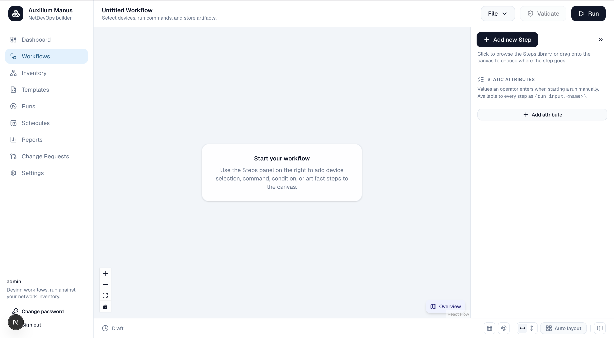
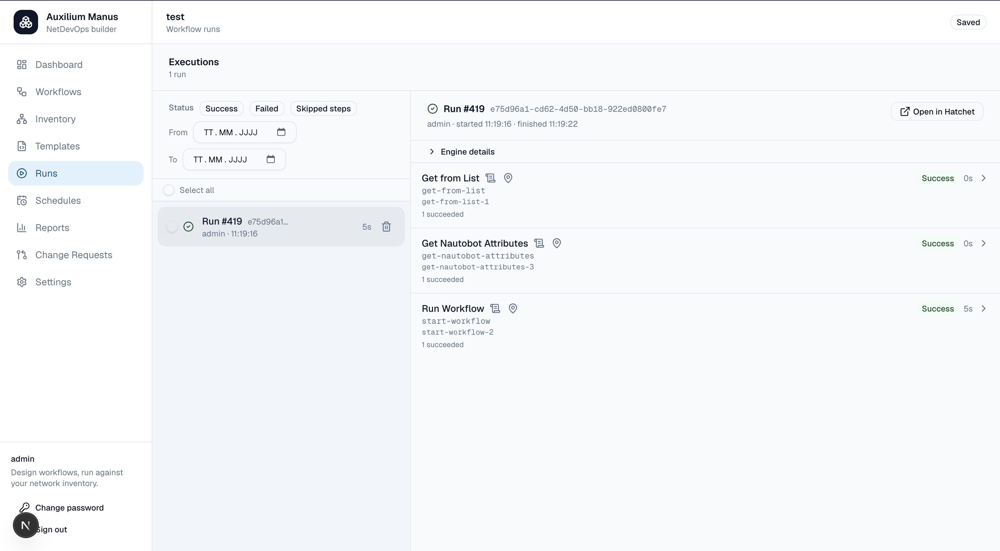
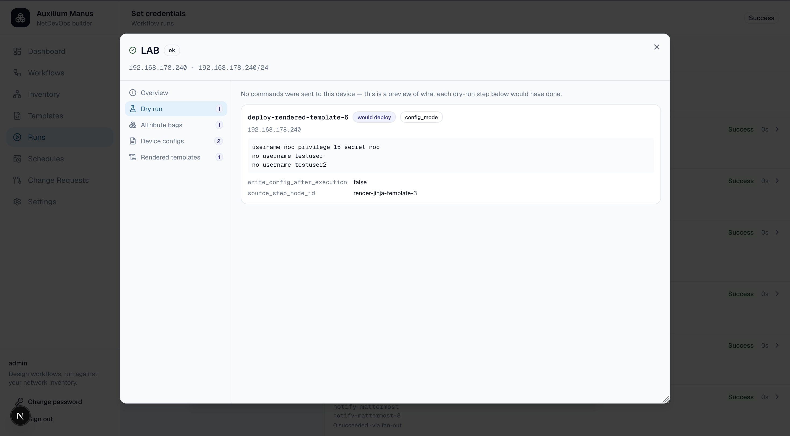
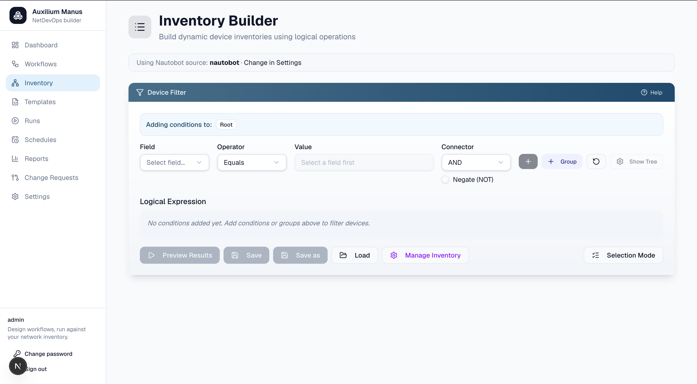
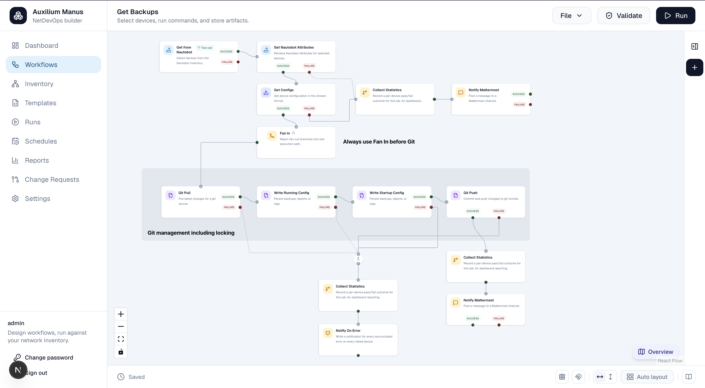
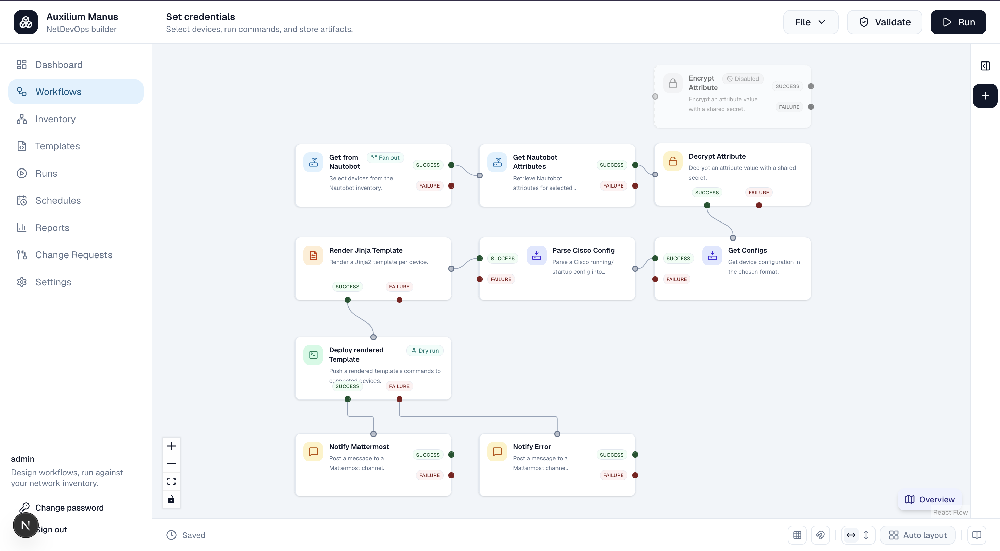
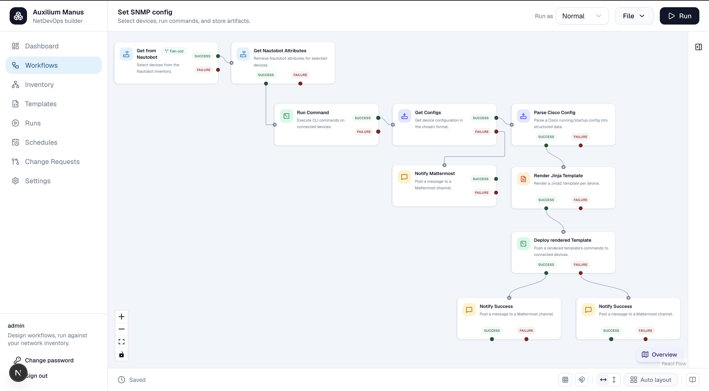
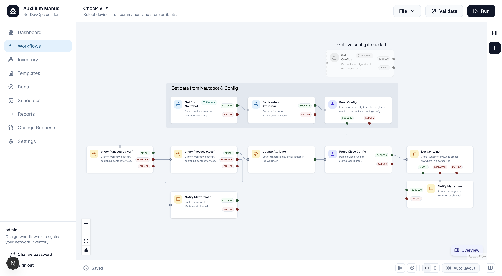
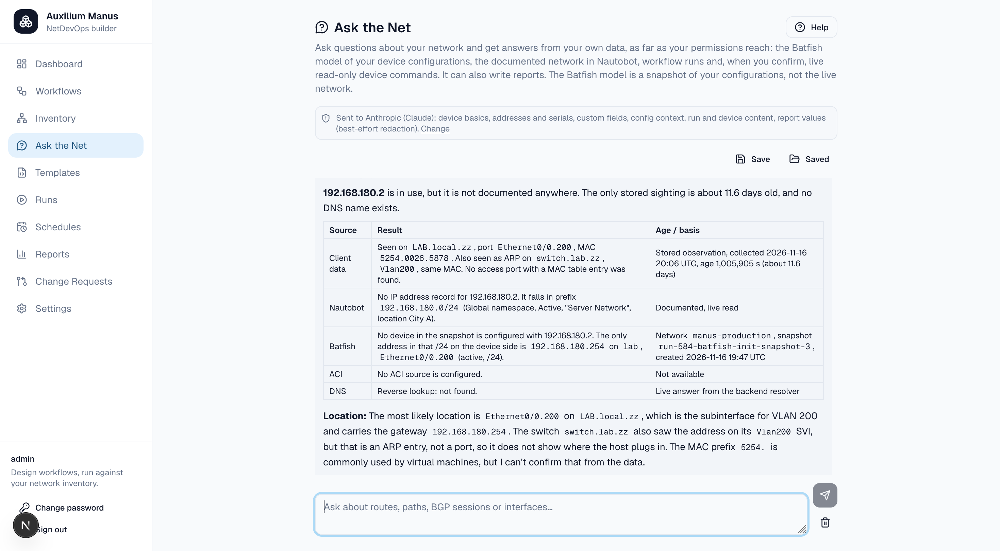

# Auxilium Manus

*Auxilium Manus* — Latin for "helping hand" — is a NetDevOps workflow builder for network
engineers. It lets you design, configure, and execute network automation workflows
visually, without writing a script for every task.

> **Ask your network a question.** With **Ask the Net** you type a question in plain
> words ("Where is the MAC address AA:BB:CC:00:01:00?", "Why is 10.1.2.3 not reachable
> from r1?", "Do a live check of core1") and the assistant answers from every source
> Auxilium Manus knows: Nautobot, a Batfish model of your configs, the git config backups,
> Cisco Catalyst Center, Cisco ACI, client data, workflow runs, and, after you confirm a
> card, read-only commands on the live device. Few open source tools offer anything like it.
> See [Ask the Net](#ask-the-net).
>
> **AI-native, with guardrails.** Besides Ask the Net, an **in-app assistant** (your own
> provider and key) authors workflows and templates, explains failed runs, and builds
> reports, and an **AI collaborator** writes directly into an open workflow through the
> same code path the UI uses. The model never runs anything by itself: it reads, or it
> proposes, and nothing is saved or executed until you click. Every change is yours to
> review and is audited. See [AI in Auxilium Manus](#ai-in-auxilium-manus).

## What it does

Network automation usually means one-off scripts: a Python file that logs into a device,
pulls config, maybe pushes a change, and prints the result. Auxilium Manus replaces that
with a visual, repeatable workflow model:

- **Pick devices from inventory** — pull live device data from Nautobot (or a static
  inventory) and select one or more targets before building a workflow around them.
- **Design workflows on a canvas** — compose steps (get config, run a command, render a
  Jinja template, evaluate a condition, write to Git, update Nautobot/ISE, store an
  artifact, snapshot and diff structured device state via pyATS, analyze routing,
  reachability, and ACLs offline via Batfish, read devices from Cisco Catalyst Center,
  send an email, start another workflow, …) as nodes on a React Flow canvas,
  connected by dependency-aware edges. The output of one step becomes the input of the
  next.
- **Compose workflows from workflows** — a **Run Workflow** step starts another workflow
  (a backup workflow, say) as a run of its own and hands it the current devices, either as
  one run for all devices or one run per device. It can wait for the child runs to finish
  and routes each device through success or failure by the child's result. The child runs
  as the triggering user, so it cannot do anything that user could not do by hand.
- **Report across the whole fleet** — a workflow runs per device, so nothing else sees the
  fleet as a whole. A **Store for Report** step records small per-device facts (serial,
  model, interface states, …) and the **Reports** app turns them into tables, numbers and
  charts across all devices, as saved reports, stored snapshots, PDF exports, and email.
  See [doc/REPORTS.md](doc/REPORTS.md).
- **Ask the network** — the **Ask the Net** page answers free questions about your
  network (where is this host, what is r1 connected to, are all BGP sessions up, which
  interfaces have errors) from Nautobot, Batfish, config backups, Catalyst Center, ACI,
  workflow runs, and confirmed read-only device commands, with ready-made playbooks for
  the common checks. See [Ask the Net](#ask-the-net).
- **Ask the built-in AI assistant** — configure your own LLM provider and key, then use
  chat panels in the template editor, workflow builder, runs page, inventory page, and
  Reports app to draft workflows and templates, explain why a run failed, or query
  inventory. It reads freely but only *proposes* changes, which you review as a diff.
  See [doc/ai_integration/AI_ASSISTANT.md](doc/ai_integration/AI_ASSISTANT.md).
- **Run once or fan out** — execute a workflow interactively against a single device, or
  fan it out into a parallel per-device child workflow across an entire device group.
- **Independent branches run in parallel automatically** — if the canvas has two (or
  more) steps with no dependency on each other, the engine runs them concurrently by
  default, no configuration needed. This is a separate axis from fan-out: fan-out
  parallelizes one branch across many devices, this parallelizes different branches
  against the same device/run.
- **Get durable, resumable execution** — runs are orchestrated by Hatchet, so long-running
  or multi-device workflows survive worker restarts, support retries, and can wait at an
  approval gate (Wait & Run) or end early at a Stop Here step for mid-run inspection.
- **Keep an audit trail** — every run is stored separately from the workflow definition,
  with per-step status, logs, and results. Command output, device configuration backups,
  and other generated artifacts are persisted as durable, downloadable artifacts.
- **Version-control workflow definitions (optional)** — turn version control on for a
  workflow and every save is also committed and pushed to a configured Git repository, so
  you get commit history, a side-by-side diff between versions, and one-click restore of an
  older version. The database stays the source of truth either way; Git is an additional,
  best-effort mirror, not a replacement for it.
- **Get notified when something goes wrong** — wire a workflow's failure paths to a
  shared error-sink step that posts to a Mattermost channel (and/or the in-app
  Notifications dashboard) with the failing device, step, and error message, instead of
  someone having to go check a run's logs to find out it failed.
- **Stage changes for review before deploy** — end a workflow with an **Open Change
  Request** step: rendered configs are committed and pushed to a per-change Git branch
  (`manus/cr-{run.id}`), a unified diff is stored, and a **Change Request** row is
  recorded in the local database (`status="staged"`). A reviewer approves it in the
  Change Requests UI (or a signed Git webhook does) and a separate **deploy run**
  continues the pipeline — loading the reviewed files via **From Change Request** and
  applying them to devices. The long review lives as a database row, not a suspended
  workflow, so approval can take arbitrarily long. See
  [doc/CICD_PIPELINE.md](doc/CICD_PIPELINE.md).
- **Collaborate with an AI directly on a workflow** — enable AI Collaboration on an open
  workflow (a time-boxed consent flag, not a shared login) and describe what you want in
  chat; the AI writes steps directly into that same workflow through the real service
  layer, validates the result before you run it, and can draft reusable templates and
  write the workflow's wiki notes along the way. See
  [doc/ai_collaboration/PROCESS.md](doc/ai_collaboration/PROCESS.md).

Under the hood, a workflow definition is a backend-owned JSON graph (distinct from the
React Flow canvas/UI state), validated and compiled into executable steps by the backend.
Steps that talk to devices use Netmiko over SSH; steps that need structured, parsed
device state (rather than raw CLI text) build a pyATS testbed and use Genie to fetch and
parse config or "learn" live feature state; steps that talk to inventory use the Nautobot
API; results run through role-based access control so only authorized users can view or
trigger specific workflows and settings.

## Key features

- Visual, drag-and-drop workflow canvas (React Flow) with live validation
- Device-first design: select inventory targets, then build the workflow around them
- Nautobot integration for device inventory, attributes, and updates
- Optional Cisco ISE integration (device add, TACACS+ key management)
- Cisco Catalyst Center integration: select devices, run read-only commands, fetch running
  configs, and read device details, topology, and health scores through the REST Intent API
  (see [doc/CISCO_CATALYST_INTEGRATION.md](doc/CISCO_CATALYST_INTEGRATION.md))
- Deeper Nautobot steps: start and check Nautobot jobs, update devices, interfaces and
  config contexts, add metadata (locations, device types), remove devices (optionally with
  their IP addresses), and read or split virtual chassis (switch stacks)
- Route to Agent: send selected attributes and content to your own Python **agent** (HTTP, or Redis for
  agents on other hosts), encrypted and authenticated end to end, and use its JSON answer in the workflow
  (see [doc/AGENT_INTEGRATION.md](doc/AGENT_INTEGRATION.md); the reference agent is in [agent/example-agent/](agent/example-agent/); a second one, `agent/get-ip-addresses/`, is an independent copy)
- Workflow-calls-workflow: the **Run Workflow** step starts another workflow with the
  current devices, per run or per device, optionally waits for it, and branches on its
  result
- Git-backed steps for cloning, pulling, and pushing configuration/templates
- Jinja2 template rendering and config deployment to devices via Netmiko/SSH
- Durable, retryable background execution via Hatchet, with per-run logs and artifacts
- Fan-out execution: run a workflow across every device in a group in parallel
- Automatic branch-level concurrency: independent canvas branches (steps with no
  dependency on each other) run in parallel by default — no toggle, no extra config —
  layered on top of, and independent from, per-device fan-out
- pyATS/Genie integration: build a testbed, fetch and parse running config, capture a
  "learn" snapshot of live feature state (BGP, OSPF, interfaces, platform, …), and diff a
  snapshot against a stored reference using Genie's structure-aware diff
- Batfish integration: build an offline network snapshot from collected device configs
  and answer routing, reachability, and ACL questions against it — routing tables, path
  checks, ACL checks, OSPF/BGP facts, node/interface properties, and general config-fact
  extraction/validation — without touching live devices
- Reports app: **Store for Report** collects per-device facts in the database; a
  declarative query engine (filters, grouping, metrics, history over time) feeds an Explore
  tab, saved reports with table/number/bar/line sections, immutable snapshots, report
  templates, PDF export, and email delivery
- Ask the Net: a chat page for questions about the network, with tools for Batfish,
  Nautobot, git config backups, Catalyst Center, Cisco ACI, client data, workflow runs,
  reports, and user-confirmed read-only device commands (live checks, interface errors and
  utilization, CDP/LLDP and routing neighbours, OSPF/BGP learn, ping/traceroute), plus
  reviewed playbooks and admin-released workflows it may propose to run
- In-app AI assistant: bring your own provider (Anthropic Claude, Google Gemini, or any
  OpenAI-compatible endpoint such as Ollama) and private API key; the assistant acts with
  your own permissions, has no execution tools, proposes changes as reviewable diffs
  validated before you see them, and sees device, run, or report data only with your
  opt-in; saved conversations
- Email: **Send Mail** step through a mail server an administrator configures
- Notifications: write in-app notifications and/or post to a Mattermost channel, either
  per-step or from a shared error sink that reports every accumulated failure across a
  run's fanned-out devices
- Optional Git-backed version control for workflow definitions: per-workflow opt-in,
  auto-commit and push on save, commit history with a diff view, and one-click restore
- Staged change requests (CI/CD gate): Open Change Request pushes configs to a Git
  branch and records a Change Request in the local DB; Approve & Deploy (or a signed
  Git webhook) starts a separate deploy run that applies the reviewed change
- Credential vault (encrypted at rest by default, or per-credential in OpenBao when
  enabled) with SSH login/SSH key/token credential types, and RBAC-protected settings,
  users, and workflows
- Secret Manager: generate, rotate, and read operational secrets (TACACS+ keys, SNMP
  community strings/SNMPv3 credentials, …) from a workflow at run time, stored in an
  external OpenBao backend chosen per connection
- AI workflow collaboration: a restricted, RBAC-scoped `ai-assistant` identity, per-workflow
  time-boxed consent sessions, four-tier static validation (schema, reference existence,
  capability flow, attribute-path wiring) gating both an explicit Validate action and run
  dispatch itself, near-live canvas sync via polling, and AI-authored templates and wiki notes

## Tech stack

**Frontend:** Next.js (App Router), React, React Flow, TypeScript, Tailwind CSS, Shadcn
UI, TanStack Query, Zustand, React Hook Form, Zod

**Backend:** FastAPI, Python, PostgreSQL, SQLAlchemy, Redis, JWT auth, Hatchet, Netmiko,
GitPython, pyATS/Genie

**Integrations:** Nautobot API, Cisco ISE, Cisco Catalyst Center, Cisco ACI, pyATS, Batfish, Mattermost, OpenBao

## The app

**Workflow editor** — design automation on a visual canvas; drag steps from the panel on
the right to get started:

**View the result of a run** — browse run history, see per-step status and duration, and
inspect fan-out runs across multiple devices:

**Look at the result of a device** — drill into a single device to inspect attribute bags,
configs, command output, and rendered templates from that run:

**Build your Nautobot inventory** — filter devices from a Nautobot source with logical
expressions and preview the matching targets before you run a workflow:

## Examples

**Config backup workflow** — selects devices from Nautobot, pulls their running and
startup configuration, and commits the backups to a Git repository (with Mattermost
notifications on failure):

**Set credentials workflow** — selects devices from Nautobot, reads their configuration,
parses Cisco config, renders a Jinja template to set credentials and remove old users,
and deploys the result back to the devices (with Mattermost notifications on success or
failure):

**Set SNMP config workflow** — selects devices from Nautobot, reads their configuration,
parses Cisco config, renders a Jinja template to configure SNMPv3 and remove legacy
SNMPv1 settings, and deploys the result back to the devices (with Mattermost
notifications on success or failure):

**Check VTY workflow** — selects devices from Nautobot, reads and parses their Cisco
config, and branches on whether the VTY lines are missing an access-class or otherwise
unsecured, posting a Mattermost notification for whichever condition matches:

## Ask the Net

Most network tools make you go to the data: open Nautobot for what is documented, the
controller for health, a terminal for the live state, the backup repository for the
config, and stitch the answers together yourself. **Ask the Net** turns that around. You
ask one question in plain words, and the assistant picks the right sources, reads them,
and answers in one place, saying where each fact came from and how old it is. Only a
handful of open source tools offer anything comparable.

The **Help** button on the page ("What can I ask?") lists every tool with example
questions; clicking a question puts it into the message box.

**Where is this host?** — asked about an IP address, the `where-is-this-host` playbook checks
client data, Nautobot, Batfish, ACI, and DNS in a fixed order and sums up what each source
says and how old its data is, followed by the most likely location of the host:

### What you can ask

| Source | Example questions |
|---|---|
| **Playbooks** (reviewed procedures, one summary table) | "Do a live check of core1", "Where is the MAC address AA:BB:CC:00:01:00?", "Where is the prefix 192.168.178.0/24 configured?", "Why is 10.1.2.3 not reachable from r1?", "Show me the uplink utilization on 10.1.2.3" |
| **Batfish** (offline model built from your configs) | "Which route does 10.1.2.3 use on r1?", "Are all BGP sessions established?", "Does the ACL EDGE-IN on r1 permit TCP 443 from 10.1.1.1 to 10.2.2.2?", "Which devices have no NTP server configured?", "Which flows work in the old snapshot but not in the new one?" |
| **Nautobot** (documented inventory) | "How many devices are in Nautobot?", "Which device has the MAC address aabb.cc00.0100?", "What is the next free IP address in 10.1.2.0/24?", "Which virtual chassis exist?" |
| **Cisco Catalyst Center** | "How healthy is LAB according to Catalyst Center?", "What devices are part of site Global/EMEA/Berlin?", SD-Access fabric, virtual networks, border handoffs and transits |
| **Cisco ACI** | "Where is 10.1.1.5 in ACI?", "Can 10.1.1.5 connect to 10.1.2.5 on tcp 443?", "Which contracts connect the EPGs web and db?" |
| **Config backups** (git) | "Get the running config of r1", search every backed-up config for a string |
| **Live device commands** (you confirm each card) | Read-only show commands, ping and traceroute, interface errors and utilization, output parsed with TextFSM or Genie |
| **Neighbours** | "What is core1 connected to?": CDP/LLDP and routing neighbours, compared with Nautobot cabling and the Batfish model |
| **OSPF and BGP learn** | "Learn OSPF of r1", "Show me the BGP state of r1", and compare two BGP readings to see what changed or flapped |
| **Workflow runs** | Which step failed and why, and what a step produced |
| **Reports** | "Write a report that lists the device type of the network devices grouped by the location": a card you click to generate, then download as PDF or CSV |
| **File comparison** | Compare a column of a CSV file in git with a Nautobot field (serial number, name, IP, location, version) |
| **Released workflows** | Describe and start a workflow an administrator released for Ask the Net, such as "Walk through the network starting at core1" |

Every device tool takes an inventory name or an IPv4 address.

### Safe by design

- **It acts as you.** Each tool group is offered only if you hold its permission, and the
  permission is checked again on every call. A viewer sees fewer tools than an operator.
- **Nothing runs without your click.** Device commands, feature learns, neighbour
  discovery, reports, and workflow runs are *proposals*: a card with exactly what will
  happen. The commands come from a reviewed, per-platform catalogue, never written by the
  model, and an operator switch turns device commands on at all.
- **You decide what the model sees.** Per-user switches for inventory, addresses, and
  content gate every field before it leaves the server; credentials are always redacted.
  Some answers (the file comparison) are built entirely on the server: the model only gets
  counts, you get the lists.
- **Your model.** The same provider and key as the in-app assistant: Anthropic Claude,
  Google Gemini, or any OpenAI-compatible endpoint, including local models via Ollama.

See [doc/AI_TOOL_CHAIN.md](doc/AI_TOOL_CHAIN.md) for the tool chain, its gates, and the
playbook format.

## Reports

A workflow runs once per device, so a single run never shows the whole fleet. Reports
close that gap:

- **Collect** — add a **Store for Report** step to a workflow. It writes small, flat facts
  per device (or per list element, such as one row per interface) into a named dataset.
  Each execution is one *collection*; reports read the newest collection per device, or the
  full history.
- **Explore** — pick a dataset from the catalog, filter, group, and aggregate (count,
  distinct count, sum, average, min, max) and see the result as a table, number, bar, or
  line chart. Queries are declarative JSON; there is no free SQL.
- **Save and share** — compose sections into a saved report, generate immutable snapshots
  of it, start from report templates, export to PDF, or send it by email.
- **Ask the AI** — the Reports page has an assistant panel (see below) that can build
  queries from your question, but only sees report data if you opt in.

See [doc/REPORTS.md](doc/REPORTS.md) for the data model and query spec.

## AI in Auxilium Manus

Most automation tools either have no AI or give you a chatbot that suggests a snippet
to copy by hand. Auxilium Manus treats AI as a first-class, safely constrained participant
in the product:

| | In-app assistant | AI collaboration |
|---|---|---|
| **Who** | Chat panel inside the app, acting as *you* | An external AI session acting as its own audited `ai-assistant` user |
| **Writes** | Proposals only, accepted by you as a diff | Directly into the open workflow, within a time-boxed consent session |
| **Can execute?** | No (Ask the Net: only after your click on a proposal) | No (no `workflows:execute`, no `credentials:reveal`) |
| **Validated** | Before you ever see the proposal | Four validation tiers; the same validator blocks a run |

What sets this apart:

- **The AI works on the real thing.** It reads and writes the same workflows, templates,
  runs, inventory, and reports your team uses, through the same services. There is no
  separate "AI copy" to reconcile.
- **Safe by construction, not by promise.** The guardrails are structural: missing
  permissions and absent execution tools, not a prompt that asks the model to behave. A
  prompt-injected model can at worst produce a bad proposal you see as a diff.
- **Self-correcting.** Output is run through the schema, reference, capability-flow, and
  attribute-path validators, and the model gets the findings back to fix its own draft.
- **Auditable.** AI-made changes are attributed to the AI, kept apart from your edits in
  the audit trail and the version-control mirror.
- **Your choice of model and data.** Anthropic Claude, Google Gemini, or any
  OpenAI-compatible endpoint including local models via Ollama. Operators decide which
  providers and data types are allowed at all.

### In-app AI assistant

Separate from AI collaboration below (an *external* AI session writing into a workflow),
the in-app assistant is a chat panel inside the product itself:

- **Your provider, your key.** Each user configures Anthropic Claude, Google Gemini, or an
  OpenAI-compatible endpoint (which covers Ollama), with a private API key. Operators
  control which providers and which kinds of data are allowed at all.
- **Where it lives.** Template editor, workflow builder, runs page, inventory page,
  Reports page, and the [Ask the Net](#ask-the-net) page.
- **What it does.** Author workflows and Jinja templates, explain a failed run, answer
  questions about inventory and device attributes, and build report queries.
- **It acts as you.** Every tool call goes through the same services and permission checks
  as the matching REST call; there is no assistant super-user.
- **Read freely, write by proposal.** Write tools never persist. They produce a proposal
  that is validated (and, for templates, rendered) and shown as a diff; accepting it uses
  the normal save path, so audit and version control apply.
- **No execution.** The authoring assistant cannot run workflows, open SSH sessions, or
  push to Git. On the Ask the Net page the assistant may *propose* a read-only command or
  a released workflow, which runs only after your click. Device, run, and report data is
  sent to the provider only if you opt in.

See [doc/ai_integration/AI_ASSISTANT.md](doc/ai_integration/AI_ASSISTANT.md).

### AI collaboration

Most workflow builders stop at letting an AI assistant suggest a script in a chat
window that you then copy in by hand. Beyond the in-app assistant above, Auxilium Manus
goes further: an external AI collaborator
can write directly into an open workflow, in place, through the same code path the
UI itself uses — a rare capability among NetDevOps tools.

- **A real, audited actor — not a shared login.** The AI acts as its own RBAC-scoped
  user (`ai-assistant`), seeded inactive by default and deliberately permission-limited
  (no `workflows:execute`, no `credentials:reveal`, nothing touching RBAC, users, or
  system settings — it can draft a workflow but structurally cannot run it or grant
  itself more access). You stay logged in as yourself the entire time; every AI-made
  change is attributed to `ai-assistant` in the audit trail and the version-control
  mirror, never blended with your own edits.
- **Consent is a time-boxed flag, not a standing switch.** Turning on "AI
  Collaboration" for a workflow opens a short-lived session (60 minutes by default).
  Writes are refused outside an active session, and enabling it never requires logging
  in as the AI to watch it work.
- **It writes through the real service layer — no second persistence path.** Canvas
  nodes/edges, static attributes, and wiki notes are saved via the same
  `WorkflowService` the browser uses, so version control, run history, and change
  tracking all behave exactly as if you had made the edit by hand.
- **Four tiers of static validation before anything runs.** Schema conformance,
  reference existence (do the referenced credentials, git repos, sources, and
  inventories actually exist?), capability-flow analysis (can a step's declared
  inputs actually be satisfied by something upstream, walking the same graph the
  execution engine would?), and advisory attribute-path wiring checks. The same
  validator blocks a run server-side when hard errors remain — whether the workflow
  was AI-authored or hand-built.
- **Near-live sync, without clobbering your work.** The open canvas polls while a
  session is active and shows a "Reload" banner when the AI has made a change, instead
  of silently overwriting whatever you're mid-edit on.
- **Not limited to canvases.** The same actor and consent model extend to authoring
  reusable templates and a workflow's wiki notes (Purpose/Assumptions/Gotchas/Example),
  so the AI documents what it built as it builds it.

See [doc/ai_collaboration/PROCESS.md](doc/ai_collaboration/PROCESS.md) for the full
design, [doc/ai_collaboration/AI_DEFAULTS.md](doc/ai_collaboration/AI_DEFAULTS.md) for
the value defaults it resolves (credentials, git repos, inventories, sources), and
[doc/ai_collaboration/AI_VOCABULARY.md](doc/ai_collaboration/AI_VOCABULARY.md) for the
confirmed phrase-to-step mappings that make its first draft more likely to match
intent.

## Installation

See [INSTALL.md](INSTALL.md) for prerequisites, first-time setup and running the app locally,
and [docker/README.md](docker/README.md) for the Docker deployment.

## Security

> **Before you deploy:** Manus is for trusted users (a workflow author can use every global SSH
> credential). Put TLS and a reverse proxy in front of port 3000; never expose port 8000, Hatchet
> or the optional services. Read [SECURITY.md](SECURITY.md), which also explains how to report a
> vulnerability.

## License

Apache License 2.0 — see [LICENSE](LICENSE).

## About this project

This project was built largely through *vibecoding* — iterative development with AI
assistants rather than hand-written code from scratch. Most of the implementation was done
with [Claude](https://claude.ai) and [Cursor](https://cursor.com), using models such as
Claude Sonnet 5 and Composer. The codebase has also been reviewed and analyzed with Fable
and other models along the way.

You are welcome to use this software for free, but **at your own risk**. The current
version is not yet stable; you may encounter bugs, incomplete behavior, or breaking
changes. New features and fixes will be added from time to time as the project evolves.
